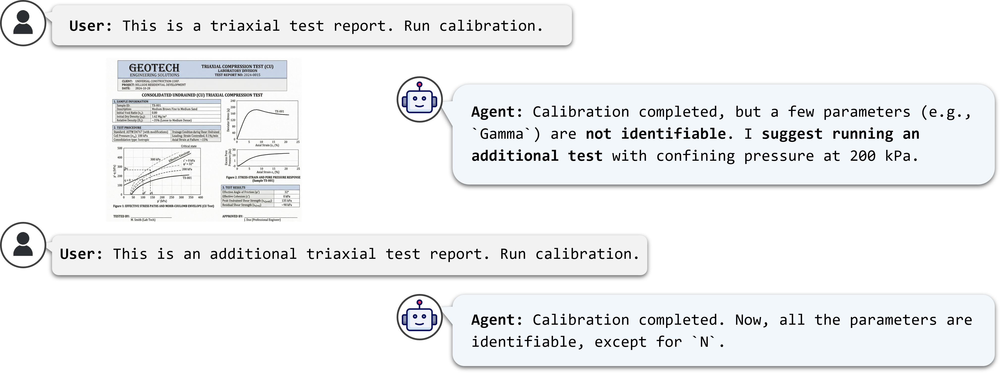
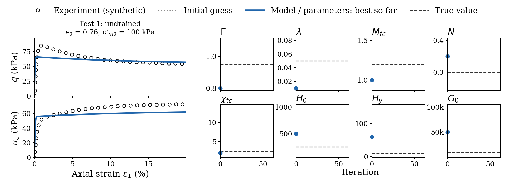
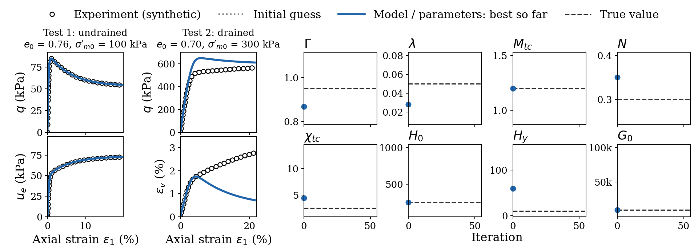

# Agentic calibrate–diagnose–suggest workflow for soil constitutive models

[](LICENSE)
[](https://www.python.org/)
[](https://pytorch.org/)
[](https://github.com/langchain-ai/langgraph)
[](https://doi.org/10.1016/j.compgeo.2026.108851)

In soil constitutive model calibration, a good curve fit can easily hide the wrong soil parameters. How do you know what’s missing, and which lab test to run next? Resolving this typically requires specialized model expertise, which isn’t always easily available.
Our new agentic AI workflow autonomously runs parameter calibration, diagnoses the hidden ambiguity, and tells you which test to run next based on embedded constitutive knowledge. 



> Play the animations to see the result example.



*Round 1.* One undrained test is fitted well, yet several parameters settle away from their true values (dashed lines).



*Round 2.* The agent proposes a follow-up test and recalibrates on both tests.

## How it works

1. **Calibrate.** A differentiable PyTorch NorSand model (`src/norsand_model.py`) is fitted to the test data by gradient-based optimization.
2. **Diagnose.** The Fisher information matrix of the fitted model shows which parameter combinations the tests do not constrain.
3. **Suggest.** The agent (`src/calibration/agent/`) reads the diagnosis and proposes the conditions of a follow-up test. A human approves every step.

## Installation

```bash
pip install -r requirements.txt
```

The agent needs an OpenAI API key: copy `.env.example` to `.env` and fill it in.

## Quick start

```bash
# Agent on the paper's running example (synthetic data)
python src/calibration/agent/run_agent.py

# A single calibration without the agent
python src/calibration/run_solver.py --config data/synthetic/case01_undrained_loose_p100_calibration.yaml
```

## Using your own test data

> We are working on an interactive GUI app. Currently only CLI demo is availabe. 

```bash
# A PDF report that tabulates the stress-strain data
python src/calibration/agent/run_agent.py --report data/example_report.pdf \
    --template src/calibration/configs/config.yaml

# Test conditions in a report, curves in a separate file
python src/calibration/agent/run_agent.py --report my_test.txt --data my_test.tsv \
    --template src/calibration/configs/config.yaml
```

- `--report`: a free-form `.pdf`, `.txt` or `.md` file. The agent extracts the test conditions and, if the report tabulates the curves, the data as JSON. It asks you to confirm what it extracted.
- `--data`: one file per test, tab-separated with a header row or JSON. Columns: `eps1` (%), `q` (kPa), and `ue` (kPa) or `epsV` (%, positive in contraction).
- Tests may have different numbers of points and strain spacings.
- `--template`: initial guesses, search bounds and solver settings. Adjust the bounds to your soil.

## Reproducing the paper

> The code has been improved since the paper, so results can differ from those in the paper. Results can also vary slightly with the Python environment and machine.

```bash
python reproduce.py --cases 1  # the running example only
```

LLM output is stochastic and not reproducible run to run, so the script replays the agent's recorded decisions instead of calling the LLM.

## Tests

```bash
pytest -m "not slow"
```

`src/norsand_model.py` is a PyTorch port of the NorSand VBA spreadsheet implementation by the model's original author; `tests/ref_data/` holds reference curves computed with that implementation.

## Citation

Choi, Yongjin, Ok, Seungwon, Lee, Junhyeong, Ryu, Seunghwa, and Choo, Jinhyun (2027). An agentic-AI calibrate–diagnose–suggest workflow for parameter identification in soil constitutive models. *Computers and Geotechnics*, 203, 108851. https://doi.org/10.1016/j.compgeo.2026.108851

```bibtex
@article{Choi2027,
  author  = {Choi, Yongjin and Ok, Seungwon and Lee, Junhyeong and Ryu, Seunghwa and Choo, Jinhyun},
  title   = {An agentic-{AI} calibrate--diagnose--suggest workflow for parameter identification in soil constitutive models},
  journal = {Computers and Geotechnics},
  volume  = {203},
  pages   = {108851},
  year    = {2027},
  doi     = {10.1016/j.compgeo.2026.108851}
}
```